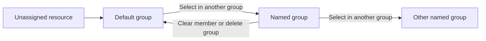

# Groups

TL;DR: assign each app or website to one group. Use a group as a rule target or merge dashboard rows by group.
Default contains every resource without another group. Membership applies to all stored history.

## Manage groups

Open Groups beside search in All browsed sites on the dashboard, or from the rules page. Create a group with a name.
Select a group to change its name, delete it, or change its members.
Saved groups appear before resource history finishes. A loading message covers resource discovery; failed reads offer Retry.
Names must be nonempty and unique, without a case distinction.

The member list includes installed apps, resources from stored history, and saved members.
It sorts by active time across all devices, highest first. Audio and idle time do not count.

The list reads the saved dashboard summary, so it never scans raw history.
Search by name or identifier. Add an unseen website with its hostname, without a path.
A website member covers that stored hostname. Assign subdomains separately.

Default cannot be renamed or deleted. To move a resource out of Default, select it in another group.
A deleted group matches nothing. A rule whose targets all refer to deleted groups becomes disabled.
The rules list keeps the deleted target's last name.

## Dashboard and rules

On mobile, the three dashboard merge controls stack right-aligned below the title, before search.
The first shares the entry-count row. Hide brief stays on the title line.

Merge by group replaces the name and subdomain merges while the checkbox stays selected.
Hide brief applies to the combined group totals. Default alone stays visible, even without activity.
A group row opens the existing activity view with the group name and current members.
That view offers Manage group and Limit this group.

Group navigation uses buttons with the shared style and navigation helper, including the phone menu.

The Apps & websites dropdown filters the activity view without a change to group membership.
Overview contains two compact stacked bars: Apps & websites and Devices. Each bar totals 100% when data exists.
Apps & websites and Devices share checkbox lists and arrows. The shared dropdown component makes each list use its button's font.
Both lists grow beyond their buttons and wrap long names; at phone widths, each list spans the screen with 12px margins.

The app choices use installed or synced app names, then names saved with group members, then identifiers when no name exists.

App segments show formatted app names. Website segments show hostnames. Device segments show device names.
Labels have 8px horizontal padding. Segments below 7% show no label; tooltips and click actions remain available.
Bar labels have no text shadow. Segment colors stay the same on hover.

The existing chart tooltip shows the full target, readable name, time, and percentage on hover or keyboard focus. Its hint uses the shared italic, muted chart style.
Both bars follow the date range, device filter, and Apps & websites filter.
Click a segment to show only that resource or device. The tooltip explains the action; both dropdowns follow the selection.

Shares use active time plus audio time, without their overlap. Each bar normalizes its own summed time.
Simultaneous use on different devices counts toward each device. Legacy browser history belongs to its original browser device.
Empty ranges show no segments. Text shortens inside small segments; every segment keeps its tooltip.

Apps & websites stays hidden unless it has at least two items. Devices stays visible with one device.
Single website and app pages show Devices too.
No border separates the bars from the statistics.

Breakdowns read device totals from the dashboard cache instead of raw history. Changed rows rebuild only affected days.
The breakdown shows a loading message until its totals arrive. Device names use the local cache without a network wait.

Groups appear first in the rule target picker, before apps and websites.
The picker and the rules list show named groups' members in parentheses, cut to one line. Default shows only its name.
A rule can target several groups or combine groups with other targets.
Group rules follow membership and name changes. Overlapping individual targets keep the existing rule behavior.

Group refreshes keep an open rule editor and its unsaved fields. Save or cancel shows the latest group labels.

## Storage and enforcement

`ui/shared/groups.js` stores membership in preferences. It does not change interval rows.
Each member keeps its source and identifier. Group names, membership, and deletions sync with end-to-end encryption.
Rules and other settings stay local.

Backups include group membership with the settings.
A restore gives deleted groups new IDs and updates imported rule targets.
Dashboard totals keep their existing identifier-based shape.

Rules keep their selected groups in `groupTargets` and their core matchers in `matchers`.
One preference write saves membership and the changed rule matchers together.
Named groups use existing host and exact matchers. Default uses a regular expression per source.
The expressions exclude assigned identifiers and cover new identifiers without a row migration.

The vendored core still computes every rule verdict.

For browser requests, Default uses a broad redirect at priority 1 and exact allowances at priority 2.
Other redirects use priority 3, so an allowance cannot defeat another limit.
This avoids Chromium's compiled-regex limit. Default redirects preserve the original URL in the fragment.

The publisher changes existing browser rules when membership changes.
Blocked tabs return when the resource leaves the rule, even when other members remain over the limit.
See the [Chromium API](https://developer.chrome.com/docs/extensions/reference/api/declarativeNetRequest) for priorities, regex limits, and substitutions.

## Same-name groups from other devices

Groups with different IDs stay separate until you choose.
The Groups page asks whether to merge their members or keep the groups separate.
The choice syncs to other devices. A merge keeps local rules attached to the surviving group.
An offline device cannot restore a deleted group through a stale name change.

## Checks

`node scripts/os/groups-loading-smoke.mjs` checks delayed reads; `--fail-groups` and `--fail-resources` check Retry.

Run `node scripts/os/groups-smoke.mjs`. It uses the capture backend and the configured second monitor.
It checks group actions, rule creation, core matches, core verdicts, browser rules, and dashboard navigation.
Screenshots go to `shots/groups-smoke-*.png`.
`node scripts/os/sync-smoke.mjs` checks group sync between two browser profiles with a local server.

Android 15 emulator checks cover the rule editor during repeated group refreshes. Other native group actions need a live check.
